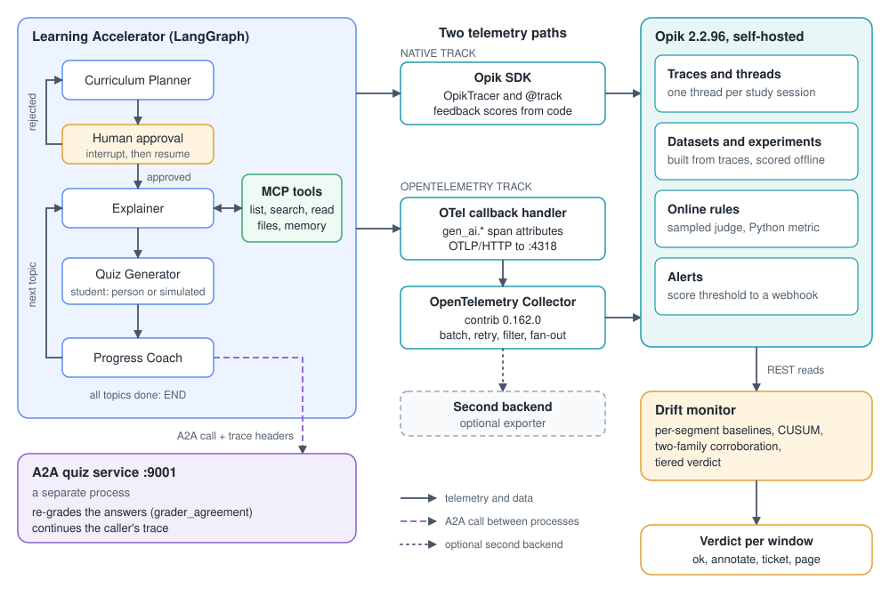

# silent-drift-lab

An open-source lab that shows how a multi-agent LLM system gets worse while every dashboard stays green, and the observability stack (Opik + OpenTelemetry) plus the drift monitor that catches it.

[](https://github.com/sandeepmb/silent-drift-lab/actions/workflows/ci.yml)
[](LICENSE)
[](.github/workflows/ci.yml)

Opik is an open-source LLM observability platform from Comet; this lab runs it self-hosted. OpenTelemetry is the vendor-neutral standard for traces. Everything runs locally on Ollama (a local model runner), so there are no API keys and no signup.

<!-- TODO(demo-gif): record `make demo` (about 30 s, cut to the Act 3 verdict), save as docs/img/demo.gif. -->


```bash
git clone https://github.com/sandeepmb/silent-drift-lab && cd silent-drift-lab
make setup                # .venv with pinned deps; needs uv, Python 3.11, Docker Desktop with 8 GB
ollama pull qwen2.5:7b    # the one model: app and judge
make opik-up              # self-hosted Opik at http://localhost:5173 (first run pulls about 2 GB of images)
make services             # the quiz service on :9001 (a separate process, so traces cross a boundary)
make demo                 # healthy session, then drift injected: latency flat, errors zero, quiz score falls
```

**Works with what you already use.** `TELEMETRY_MODE=otel make run` sends the same spans through an OpenTelemetry Collector (`make otel-up`), so any backend that accepts OTLP (OpenTelemetry's wire protocol) can receive them.

**3.4 GiB idle** is what the full self-hosted Opik stack costs you. MEASURED: 8 containers, Apple Silicon, Docker Desktop at 8 GB, via `make footprint` ([how to reproduce](docs/reproducing.md)). A one-topic traced session takes about 2.7 minutes on `qwen2.5:7b` on the same machine, so `make demo` runs two of them in roughly six.

<!-- TODO(drift-headline): after `make drift-demo` lands, replace this line with the measured result, e.g. "The monitor flagged N of 6 injections at a false-positive rate of X over 30 baseline sessions." -->
**Drift result:** pending the first full `make drift-demo` run.

Read [LIMITATIONS.md](LIMITATIONS.md) before you decide this applies to your system. The student is synthetic, the sample is small, and the local model is noisy. The limits are the point of the lab, not a footnote.

---

## Architecture

<!-- TODO(architecture-svg): draw docs/img/architecture.svg (light theme): App → (native) Opik; App → (otel) Collector → Opik, with a dotted second exporter. -->


One study session, end to end:

1. `main.py` starts a LangGraph session; the session id is both the checkpoint thread and the Opik thread.
2. The Curriculum Planner proposes a plan and the graph pauses for human approval (`--auto-approve` in lab runs).
3. The Explainer reads your notes through MCP file and memory tools in a loop until it is satisfied.
4. The Quiz Generator asks questions over an A2A hop to the service on `:9001`; the student (you, or a simulated persona) answers; a grading call scores each answer.
5. The Progress Coach decides whether to re-teach or move on. Every node, model call and tool call lands in Opik as one trace; the quiz score is attached to that trace as a feedback score.

## What it measures

Observability for an agent system has three layers. Most teams have the first two.

| Layer | Examples | Who produces it here |
|---|---|---|
| Infrastructure | CPU, memory, GPU, queue depth | Docker and Ollama |
| Application | Latency, error rate, tokens, cost per request | The traces themselves; Opik's project dashboards |
| Behavioural quality | Quiz score, grader agreement, groundedness of explanations, regeneration and abandonment, tool-call failures after generation | Feedback scores from code, online evaluation rules (`make rules`), the drift monitor (`make drift-demo`) |

The drift lab injects six kinds of degradation, one at a time, and asks which layer notices. Each injection is selected with `DRIFT_SCENARIO`. The two right-hand columns are expectations from the talk's taxonomy; what the monitor measured goes in the benchmarks table once `make drift-demo` has run.

| Drift | What changes | `DRIFT_SCENARIO` | Layers 1 and 2 (expected) | Layer 3 (expected) |
|---|---|---|---|---|
| Model | The model is swapped for a smaller one; nobody deployed anything | `model_swap` | Latency may move, in the good direction | Quiz score and groundedness fall |
| Prompt and context | The system prompt is mutated; a template variable renders empty | `prompt_mutation` | Nothing | Score falls for one segment |
| Retrieval | The notes go stale; the explainer is handed worse material | `stale_notes` | Nothing | Groundedness falls while the model is fine |
| Tool and dependency | The MCP tool returns an empty or malformed result | `tool_fault` | Nothing; the model talks around it | Tool-call failures after generation, then score |
| Behavioural | The explainer gets verbose and hedges | `verbosity` | Token counts shift, inside normal variance | Output length distribution shifts, format compliance drops |
| Input and traffic | Goals arrive from a new segment (SQL) that the notes do not cover | `traffic_shift` | The overall average stays fine | One segment is on fire |

The monitor keeps a rolling baseline per segment and only raises when two behavioural signals move together. One signal moving is noise on a 7B model; that is a measured fact about this lab, not a design preference.

## Quickstart

After the install block above:

```bash
make run          # one interactive session, traced; open http://localhost:5173
make seed         # 30 scripted sessions (scenarios/sessions.jsonl) become an Opik dataset built from traces
make experiment   # offline evaluation over that dataset with the local judge
make rules        # online evaluation rules on sampled live traffic, plus one alert to a local webhook
make drift-demo   # inject each drift, run the monitor, write reports/drift-figure.png
```

`make test` runs the unit tests without Ollama or Opik. `make evals-test` runs the evaluation gate and needs both.

## Configuration

Five settings matter. The full list, with comments, is in [.env.example](.env.example); `make setup` copies it to `.env`.

| Variable | Default | What it does |
|---|---|---|
| `OLLAMA_MODEL` | `qwen2.5:7b` | The model the four agents and the simulated student use |
| `JUDGE_MODEL` | `ollama/qwen2.5:7b` | The model Opik's evaluators use as judge (a LiteLLM model string) |
| `TELEMETRY_MODE` | `native` | `native` (Opik SDK callback), `otel` (OpenTelemetry through the Collector), or `off` |
| `OTEL_EXPORTER_OTLP_ENDPOINT` | `http://localhost:4318` | Where the `otel` track sends spans; the Collector forwards them to Opik |
| `DRIFT_SCENARIO` | `none` | Which degradation to inject; the lab sets this for you |

## Benchmarks

Every number here names its standing. MEASURED means `make <target>` produced it on the hardware stated. CALIBRATED SYNTHETIC means the data is generated, with the generator's settings recorded. ILLUSTRATIVE means it shows the shape of a result and should not be quoted. Commands for each row are in [docs/reproducing.md](docs/reproducing.md).

| Figure | Value | Standing | Produced by |
|---|---|---|---|
| Opik stack, idle memory | 3.4 GiB across 8 containers | MEASURED (Apple Silicon, Docker Desktop 8 GB) | `make footprint` → `reports/footprint.md` |
| One-topic traced session | about 2.7 min | MEASURED (`qwen2.5:7b`, n = 1, same machine) | `make run` with `--max-topics 1 --student simulated` |
| Seed dataset | 30 sessions: 10 goals × 3 personas, one segment | CALIBRATED SYNTHETIC (simulated student, personas in `app/student.py`) | `make seed` |
| Drift detection | <!-- TODO(drift-table): detections / 6, false positives over the baseline --> pending | MEASURED once run | `make drift-demo` → `reports/drift-figure.png` |
| Judge agreement with hand labels | <!-- TODO(judge-agreement): N items, agreement figure --> pending | MEASURED once run | `make experiment` |
| `make demo` verdict | one healthy run against one drifted run | ILLUSTRATIVE (n = 1 each; an anecdote by design) | `make demo` |

<!-- TODO(drift-figure): once reports/drift-figure.png is generated, copy it to docs/img/drift-figure.png and embed it here with its caption from docs/reproducing.md. -->

## Limitations and non-goals

- The student is a second model call with a persona, not a person. "User" signals are simulated.
- n is small everywhere: 30 baseline sessions, one segment, a 7B model with run-to-run variance that is larger than some of the effects you are looking for.
- The Compose install of Opik is for a laptop. Comet documents it as not for production.
- Opik's OpenTelemetry endpoint accepts traces over OTLP/HTTP only; the `otel` track has no metrics or logs.
- Ollama reports no cost, so cost is a shadow price table, not a bill.
- The CrewAI study buddy from the upstream project is off by default because of an `opentelemetry-sdk` version conflict ([docs/optional-crewai.md](docs/optional-crewai.md)).
- The attribute mapping between OpenTelemetry GenAI conventions and Opik changes with Opik releases, which are frequent.

The long form, with what each limit means for your system, is in [LIMITATIONS.md](LIMITATIONS.md).

## Prior art and acknowledgments

- **Opik**, by Comet, is the observability platform the lab runs on: tracing, threads, datasets, experiments, online rules and alerts all come from it.
- **OpenTelemetry** and its GenAI semantic conventions define the span attributes the `otel` track emits.
- **LangGraph**, by LangChain, is the agent framework; the Opik LangChain callback is what makes the native track one line.
- **The Learning Accelerator** by Sandeep Bharadwaj Mannapur ([sandeepmb/freecodecamp-multi-agent-ai-system](https://github.com/sandeepmb/freecodecamp-multi-agent-ai-system), MIT) is the application under observation; the four agents, the MCP servers and the A2A service are vendored from it with their licence kept ([NOTICE](NOTICE)).
- The lab is the companion to a freeCodeCamp handbook and to the MLOps World 2026 talk *Silent Drift: Why Your LLM's Quality Is Degrading and Your Metrics Can't See It* (16 November 2026). <!-- TODO(links): add the handbook URL and the talk page once published. -->

Pinned versions, the same ones the handbook was written against: Opik 2.2.96 (server and SDK), LangGraph 1.1.0, langchain-core 1.0.0, langchain-ollama 1.0.0, `qwen2.5:7b`, Python 3.11. Opik releases often; if the UI looks different on a newer version, that is why.

## Docs map

| Document | What it is for |
|---|---|
| [LIMITATIONS.md](LIMITATIONS.md) | Where the lab's evidence stops and what that means for you |
| [docs/reproducing.md](docs/reproducing.md) | Every figure and number, and the command that produces it |
| [docs/optional-crewai.md](docs/optional-crewai.md) | Re-enabling the CrewAI study buddy in a separate environment |
| [docs/good-first-issues.md](docs/good-first-issues.md) | Scoped first contributions |
| [ROADMAP.md](ROADMAP.md) | The next six months, kept modest |
| [CHANGELOG.md](CHANGELOG.md) | What changed, by version |
| [.env.example](.env.example) | Every setting, with a comment each |

## Contributing, security, license

- Contributing: [CONTRIBUTING.md](CONTRIBUTING.md). Commits carry a DCO sign-off (`git commit -s`). The best first contribution is a new drift scenario; there is an [issue template](.github/ISSUE_TEMPLATE/drift_scenario.md) for it.
- Security: report privately through [GitHub's vulnerability form](https://github.com/sandeepmb/silent-drift-lab/security/advisories/new); details in [SECURITY.md](SECURITY.md).
- License: new code is [Apache-2.0](LICENSE). Vendored Learning Accelerator code keeps its [MIT licence](LICENSE.upstream-learning-accelerator); see [NOTICE](NOTICE).
- Trademarks: Opik, Comet, OpenTelemetry, LangGraph, CrewAI and Ollama are the names of their respective projects and owners. This lab is not affiliated with or endorsed by any of them.
