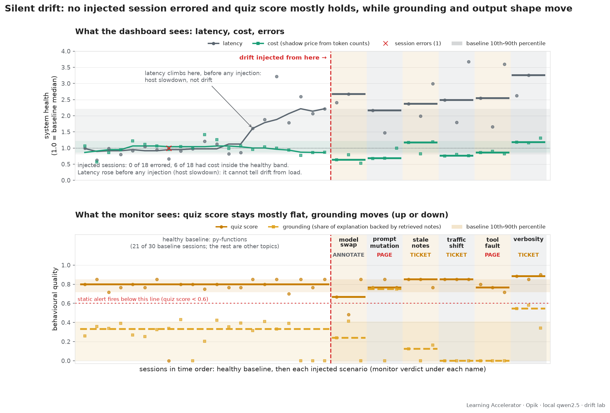

# The drift lab

> Injected drift leaves errors at zero and, in most scenarios, tokens and cost
> inside their normal range, while grounding and output shape move (up or down).
> On this lab's synthetic student the quiz score barely moves. A monitor with
> per-segment baselines, change detection and two-signal corroboration flagged
> all six injections; a static `quiz_score < 0.6` rule flagged none of them.
> Latency is the exception: it rose with host load and cannot be used here.

This document is the lab's write-up: what was injected, how, which signals
caught it, what the monitor decided, and where the evidence is thin. Every
number below comes from `reports/drift-report.md`, regenerated by
`make drift-demo` (or `python drift/run_lab.py --analyse-only` to rebuild the
reports from the traces already in Opik).

```
make drift-demo                              # 30 baseline sessions, then 3 runs/scenario, then analyse (~2.3 h of session time)
python drift/run_lab.py --quick              # 1 run/scenario
python drift/run_lab.py --analyse-only       # reports only, from Opik
python -m pytest tests/test_drift_monitor.py # monitor logic, no LLM
python drift/inject.py                       # list scenarios and their hooks
```

Outputs: `reports/drift-signals.csv` (one row per session), `reports/drift-report.md`
and `.json` (the monitor's verdicts), `reports/drift-figure.png` (dark) and
`reports/drift-figure-light.png`.

## 1. Taxonomy → scenario → hook

Each scenario is a handful of environment variables the app reads **at call
time** (lines marked `# drift hook` in `app/agents/explainer.py`,
`app/agents/quiz_generator.py`, `app/mcp_servers/filesystem_server.py`). No
redeploy, no config diff, no version bump — the dashboard has nothing to show.
`drift.inject.apply(name)` sets them, `clear()` restores them. With
`DRIFT_SCENARIO=none` every hook is a no-op.

| taxonomy | scenario | hook (env) | what changes |
|---|---|---|---|
| model drift | `model_swap` | `DRIFT_EXPLAINER_MODEL`, `DRIFT_GRADER_MODEL` = `qwen2.5:3b` | explainer and grader silently run the 3B model; the trace still carries `model:qwen2.5:7b` because that tag was computed at startup — exactly how a silent swap looks in production |
| prompt & context drift | `prompt_mutation` | `DRIFT_EXPLAINER_PROMPT_STRIP` + `DRIFT_EXPLAINER_PROMPT_SUFFIX` | the template's EXPLANATION FORMAT block is dropped and replaced by "exactly two short sentences, do not reference the notes". (Two trial runs that only *appended* that line were ignored by qwen2.5:7b: the 300–500-word format block won every time, 1.6–1.8k chars, grounded. A bad prompt deploy that loses a section is the realistic version.) |
| retrieval drift | `stale_notes` | `NOTES_PATH` → `study_materials/stale_notes` | same filenames, bodies truncated to headings or replaced by an unrelated topic (built by `drift/make_stale_notes.py`) |
| input / traffic drift | `traffic_shift` | `DRIFT_SEGMENT=sql` + SQL goals, tag `segment:sql` | goals from a segment the notes do not cover; no baseline exists for it |
| tool & dependency drift | `tool_fault` | `DRIFT_TOOL_FAULT_P=0.7` | `search_notes` / `read_study_file` return `[]`, `""`, `{"status": "ok"}` or an HTML 503 body with p = 0.7, never raise |
| behavioural drift | `verbosity` | `DRIFT_EXPLAINER_PROMPT_STRIP/SUFFIX` + `DRIFT_GRADER_PROMPT_STRIP/SUFFIX` | the format block is replaced by "≥ 900 words, five sections, hedge every claim", and the grader's score bands by "0.9 or higher for any effort". Scores may go **up**; it is a distribution shift, not a quality drop. (An appended-only version moved the explainer from ~2.2k to 2.5k chars and the grader not at all.) |

## 2. Signals (`drift/signals.py`)

Everything is pulled from the Opik REST API (`/v1/private/traces` filtered by
tag, `/v1/private/spans?trace_id=`), one row per session (= Opik thread).

| family | signal | source |
|---|---|---|
| system | `duration_ms` | sum of the session's trace durations |
| system | `error` | `session_error` feedback score |
| system | `total_tokens`, `est_cost_usd` | ChatOllama spans: `usage` or `output.generations[0][0].message.usage_metadata`; cost from a shadow price table (`DRIFT_PRICE_TABLE`), since Ollama reports none |
| user | `quiz_score`, `weak_area_count` | feedback scores logged by `main.run_session` |
| tool | `tool_failures` | `explainer.execute_tool` spans whose output is an error string, HTML, an empty string, or not the expected shape |
| tool | `empty_searches` | `search_notes` calls that returned nothing. Legitimate for a topic the notes do not cover, which is why it only means something *per segment*; under `tool_fault` the faulted `[]` is indistinguishable from a real miss, and the explainer simply never reads a file |
| tool | `parse_failures` | `quiz.grade_answer` outputs missing `score` (or the "could not grade" default), `generate_questions` fallback |
| tool | `explainer_iterations` | ChatOllama spans inside the `explainer` node (retry proxy) |
| tool | `a2a_unreachable` | `1 − a2a_reachable` feedback score (the progress coach's A2A quiz service call); NaN when the session predates the score |
| grounding | `grader_agreement` | feedback score `1 − |local grade − A2A re-grade|`; NaN when the quiz service did not answer |
| grounding | `grounding` | share of the explanation's distinctive words that appear in the notes the agent actually retrieved in that session |
| grounding | `notes_overlap` | same against the canonical `sample_notes` corpus |
| grounding | `refusal_rate` | explanations matching refusal / "your notes don't cover this" / "general knowledge" patterns |
| shape | `explanation_chars`, `sentence_count`, `hedging_rate` | final explainer message; hedges per 100 words from a regex list |

### Segments

A segment is a request-time property of the session. The seeds are tagged
`segment:python-fundamentals`, which turned out to be too coarse: the notes
cover closures, decorators and scope but not generators or context managers,
so one baseline mixed "retrieval found the notes" (grounding ≈ 0.3) with
"retrieval found nothing" (grounding 0) and came out at 0.08 ± 0.08 — blind
to retrieval drift. `drift.signals.refine_segment` therefore maps the goal
text to a topic family: `py-functions`, `py-iteration`, `sql`. The drift
scenarios' goals are all `py-functions` (or `sql` for `traffic_shift`), and
they are compared with the `py-functions` baseline only. Segmentation is what
makes grounding monitorable at all.

## 3. The monitor (`drift/monitor.py`)

1. **Per-segment baseline.** Median and MAD per signal over the baseline
   population, keyed by `(segment, persona)` when that stratum has ≥ 5
   sessions, else by `segment`, else global. Persona matters: a weak student
   scoring 0.35 is normal, not drift.
2. **Robust deviation.** `z = (x − median) / max(1.4826·MAD, floor)`. The
   floor per signal stops all-zero baselines (errors, tool failures) and
   small-integer counts from paging on a one-unit wobble.
3. **Change detection.** Two-sided CUSUM (k = 0.5, h = 4) on the z-series of
   baseline sessions in time order followed by the window; the change point is
   *confirmed* when the alarm lands inside the window. A two-window median
   shift is reported alongside.
4. **Corroboration.** A family moves when the window's median z on any of its
   signals crosses `Z_THRESH` (2.0) in either direction. System signals are
   displayed but never corroborate. A window from a segment with no baseline
   counts as the `input` family moving.
5. **Verdict.** `ok` (nothing moved) → `annotate` (one family) → `ticket`
   (≥ 2 families, no confirmed change point) → `page` (≥ 2 families and a
   confirmed change point). A segment with no baseline can ticket but never
   page: there is nothing to confirm a change against, and the ticket is
   "build the baseline".
6. **The naive rule.** `quiz_score < 0.6` on its own: how many *healthy*
   baseline sessions it pages on, and whether it fires on each window. The
   monitor's own false-positive rate is measured the same way, by sliding
   3-session windows over the baseline.

## 4. Results

Every number in this section is from `reports/drift-report.md` (and `.json`), produced by
`python drift/run_lab.py --analyse-only` on 2026-10-11/12 from the sessions listed in
`data/baseline-runs.jsonl` and `data/drift-runs.jsonl`.

**What was run.**

- **Baseline:** 30 healthy sessions (10 goals x 3 personas, one topic each) run alone on the
  GPU and tagged `baseline` (`data/baseline-runs.jsonl`; 55.7 min of session time). By topic
  family: 21 `py-functions`, 9 `py-iteration`. These are separate from the 30 seed sessions that
  feed the evaluation dataset (`docs/evals.md`): the seed sessions were run while other jobs
  shared Ollama, so their latency is not comparable.
- **Drift:** 3 sessions for each of the six scenarios, 18 in all, 0 session errors
  (`data/drift-runs.jsonl`; 81.7 min of session time). Personas cycle average / good / weak.
  Fifteen ran back to back; the third `traffic_shift`, `tool_fault` and `verbosity` sessions
  were topped up later with `--resume`. The analysis uses only the sessions in that file:
  21 other `drift:*` sessions from earlier attempts are still in Opik and are ignored, and 3
  sessions that never reached scoring are dropped (`drift-analyse-final.log` names them).
- **Monitor settings:** `Z_THRESH` 2.0, CUSUM k = 0.5, h = 4, static rule `quiz_score < 0.6`.

**Verdicts** (baseline n = 30; n = 3 sessions per scenario):

| scenario | families moved (signals) | change-point | verdict | static rule fired |
|---|---|---|---|---|
| `model_swap` | shape (explanation_chars) | no | ANNOTATE | no |
| `prompt_mutation` | grounding (grounding, notes_overlap); shape (explanation_chars, sentence_count) | yes | PAGE | no |
| `stale_notes` | grounding (grounding); shape (explanation_chars, sentence_count) | no | TICKET | no |
| `traffic_shift` | tool (empty_searches); grounding (refusal_rate); input (segment) | no | TICKET | no |
| `tool_fault` | tool (empty_searches); grounding (grounding, notes_overlap); shape (explanation_chars, sentence_count) | yes | PAGE | no |
| `verbosity` | grounding (grounding); shape (explanation_chars, sentence_count) | no | TICKET | no |

**Baseline median -> window median** for the system and quality signals (the full 18-signal
table with z-scores is in `reports/drift-report.md`):

| scenario | duration | tokens | cost (shadow) | quiz score | grounding |
|---|---|---|---|---|---|
| `model_swap` | 94s -> 251s | 8,254 -> 7,329 | $0.0030 -> $0.0019 | 0.80 -> 0.67 | 0.33 -> 0.24 |
| `prompt_mutation` | 94s -> 204s | 8,254 -> 5,717 | $0.0030 -> $0.0021 | 0.80 -> 0.77 | 0.33 -> 0.75 |
| `stale_notes` | 94s -> 222s | 8,254 -> 9,724 | $0.0030 -> $0.0035 | 0.80 -> 0.85 | 0.33 -> 0.12 |
| `traffic_shift` | 86s -> 233s | 8,041 -> 6,236 | $0.0029 -> $0.0023 | 0.80 -> 0.85 | 0.26 -> 0.00 |
| `tool_fault` | 94s -> 239s | 8,254 -> 7,182 | $0.0030 -> $0.0026 | 0.80 -> 0.77 | 0.33 -> 0.00 |
| `verbosity` | 94s -> 306s | 8,254 -> 9,912 | $0.0030 -> $0.0036 | 0.80 -> 0.88 | 0.33 -> 0.55 |

(`traffic_shift` has no baseline for its segment, so it is compared with the global baseline.)

**What this shows**

- **The monitor flagged all six injections** (none `ok`): two PAGE, three TICKET, one ANNOTATE.
  Five of six had two or more families move. `model_swap` is the weakest result: only the
  explanation length moved, and the verdict is the lowest level.
- **The static rule `quiz_score < 0.6` fired on none of the six windows.** Window medians of the
  quiz score were 0.67 to 0.88 against a baseline median of 0.80, and no quiz-score z reached
  2.0. On the healthy baseline the same rule would have paged on 1 of 30 sessions (a session
  with quiz score 0.00).
- **The monitor is not free of false alarms.** Sliding 3-session windows over the healthy
  baseline gave 28 windows: 19 ok, 5 annotate, 2 ticket, 2 page. Two false pages in 28 windows
  is a higher page rate than the static rule's 1 in 30 sessions. The two windows are
  identified, and the cause is traced, in "What the monitor got wrong on healthy data" below.
- **System signals: errors and tokens held, latency did not.** 0 of 18 injected sessions
  errored. Tokens moved in one scenario (`verbosity`, 9,912 vs 8,254, z +2.5) and cost in one
  (`model_swap`, lower, z -2.5, the "good direction" the taxonomy predicts). Duration moved in
  all six (z +2.9 to +10.2), but latency had already roughly doubled in the second half of the
  baseline, before any injection (see the top panel of the figure), so it says nothing about
  the injections. The cause was not isolated.
- **Grounding moves in both directions.** It fell for `stale_notes` (0.12) and `tool_fault`
  (0.00) and rose for `prompt_mutation` (0.75) and `verbosity` (0.55): a two-sentence
  explanation that quotes the notes is "well grounded". That is why the monitor treats a
  move in either direction as a move.
- **Quiz score is the weakest signal here**, because the student is a model that knows Python
  whatever the notes say (see Limitations).



### What the monitor got wrong on healthy data

Analysis of `reports/drift-signals.csv` plus the span-level `search_notes` calls in Opik
(read-only, no reruns). The sliding-window self-check was reproduced exactly (28 windows:
19 ok, 5 annotate, 2 ticket, 2 page).

**The two false pages.** Both are windows at the very end of the baseline, 3-session windows
ordered by time: sessions 27-29 (`2e8cdf09`, `ead46ee0`, `45c715ac`) and sessions 28-30
(`ead46ee0`, `45c715ac`, `7b14d4ce`). In both, the `tool` family (`empty_searches`) and the
`grounding` family (`grounding`, `refusal_rate`) moved, and the second window also moved
`shape` (`explanation_chars`, `sentence_count`); CUSUM confirmed a change point because the
shift sits at the end of the series. The cause is the goal, not the system: the last three
baseline sessions are the three personas for "Understand how decorators with arguments are
built". In all three the planner's first topic was "Decorators basics", the explainer searched
for that phrase (`Decorators basics`, then `decorator basics` twice), `search_notes` is a case-insensitive
substring match and returned "No matches found.", although `tool_list_files` had just listed
`decorators.md`, and the explainer never opened a file. Grounding was 0.00 and one search came
back empty in all three. That is a real retrieval miss, the same shape as `tool_fault` in
miniature, but it is a property of one goal's search phrase, not drift: the baseline puts
this goal in `py-functions`, where 15 of 21 sessions find notes. Why the model chose a phrase
that does not match is not established (temperature 0.7 for the student, 0.3 for the
explainer; one goal, three sessions, no repeat).

**The same pattern explains the other non-ok windows.** All 9 non-ok windows (5 annotate,
2 ticket, 2 page) contain at least one "notes miss" session (an empty search or grounding
0.00). 15 of the 30 baseline sessions are such misses: all 9 `py-iteration` sessions (the notes
cover closures and decorators, not generators or context managers) and 6 of the 21
`py-functions` sessions (3 for `functools`, 3 for decorators with arguments). A miss alone does
not trigger a verdict (12 of the 19 ok windows also contain one); a run of two or three
consecutive misses inside a segment whose baseline expects none does. Because the seed script
runs the three personas of a goal back to back, a 3-session window is usually one goal, so the
window is confounded with the goal.

**Not caused by the latency rise.** The pages need not have anything to do with the slowdown
described below: the `functools` window (sessions 19-21, normal speed, about 100 s) ticketed
for the same reason, and the three `lambda` sessions in the slow period (all with notes found)
were ok. System signals never corroborate in the monitor, so duration cannot trigger a page.

**One more detail about the static rule's single "false" page.** The baseline session with
quiz score 0.00 (`1160fad3`, `Understand first-class functions ...`, persona average) is not
a healthy session: it crashed after the third answer with `TypeError: string indices must be
integers, not 'str'` (`drift-clean.log`), so `error = 1.0` for it. The rule `quiz_score < 0.6`
paged on a real failure, which the error rate also shows. I kept the session in the baseline
(a healthy day has such failures) and count it against the rule, as the report does, but the
honest comparison is 2 windows paged on a retrieval miss by the monitor against 1 session paged
on a crash by the rule; neither is a benchmark at this n.

**What would fix it (not done).** Segment by goal (or by whether the first search returned
anything) instead of by topic family; widen windows so one goal cannot fill a window; or
treat the first-search outcome as an input, not a signal. Not implemented: scope is frozen.

#### The latency confound

Evidence that the duration rise is a property of the host and not of the system under test:

- Order, not scenario: median session duration is 81.5 s for baseline sessions 1-22 and 185.5 s
  for sessions 23-30 (all `none`, no injection). Duration against run order in the baseline:
  Spearman rho 0.67 (p < 0.001, n = 30); step at about the 23rd-24th session, which started around 22:50
  PDT on 2026-10-10 (05:50 UTC).
- Same workload, slower throughput: LLM calls per session are 13 (median) in every third of the
  baseline, and total tokens do not trend with run order (Spearman rho 0.05). Milliseconds per
  token (session duration over total tokens, median) went from 10.2 / 10.3 (sessions 1-10,
  11-22) to 24.7 (sessions 23-30) and 31.7 across the 18 drift sessions.
- Another instance of the same thing: the seed run's first 22 sessions shared Ollama with other
  jobs (mean 463 s) and the last 8 ran alone (mean 78.5 s) (`docs/evals.md`).
- Concurrent activity on the same machine: files of another project on the same host and Docker
  VM were being written between 22:46 and 23:45 PDT that night (a Docker-based database
  rehearsal). That coincides with the step. It is circumstantial; the load itself was not
  recorded, so the cause is not isolated.

Consequence: duration moved in all six scenarios only because every drift session ran in the
slow period. The lab supports no claim about latency, in either direction.

## 5. Limitations

- **Synthetic student.** The quiz is answered by an LLM playing a persona; it
  knows Python regardless of what the notes say, so retrieval-type drift does
  not reliably lower `quiz_score`. That is why grounding and tool signals must
  carry those scenarios, and why a real product would plug in real user signals
  (re-asks, thumbs-down, abandonment).
- **Small N.** 3 sessions per scenario against a 30-session baseline. The z's
  are medians of three; one odd session moves them. Treat the verdicts as the
  shape of the evidence, not a measurement.
- **Local model variance.** qwen2.5:7b at temperature 0.3 varies run to run;
  the baseline MAD absorbs some of it, the scale floors absorb the rest.
- **Latency is confounded.** Latency rose roughly twofold part-way through the
  baseline and stayed high through the drift sessions (see the figure), so
  duration cannot be read as an effect of any injection. The cause was not
  isolated; another process on the same machine is the likely one. The seed
  sessions were run partly while other jobs shared Ollama, which is why the lab
  runs its own baseline.
- **Grounding is a proxy.** Word overlap with retrieved text is cheap and
  explainable but it is not faithfulness; a judged score (Opik online
  evaluation rules) is the production version.
- **Two traces per session.** The approval interrupt splits every session into
  two Opik traces; signals are aggregated per thread, which is what a monitor
  should key on anyway.
